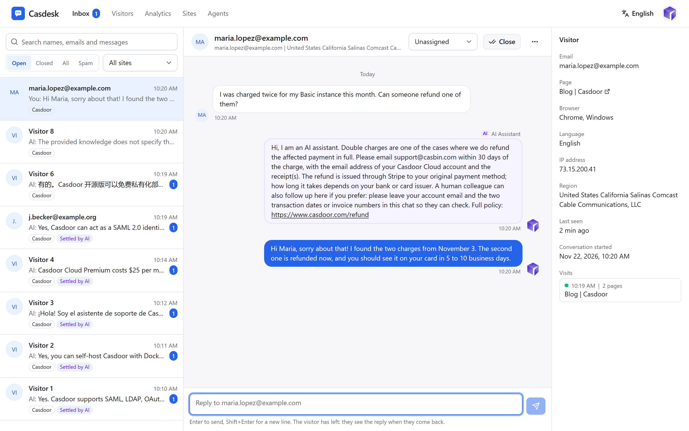
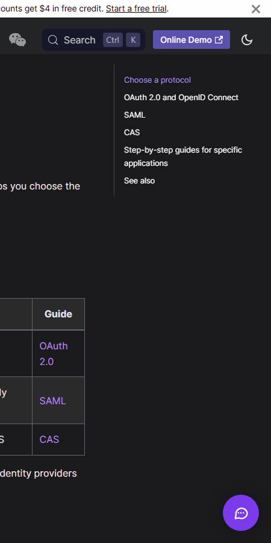
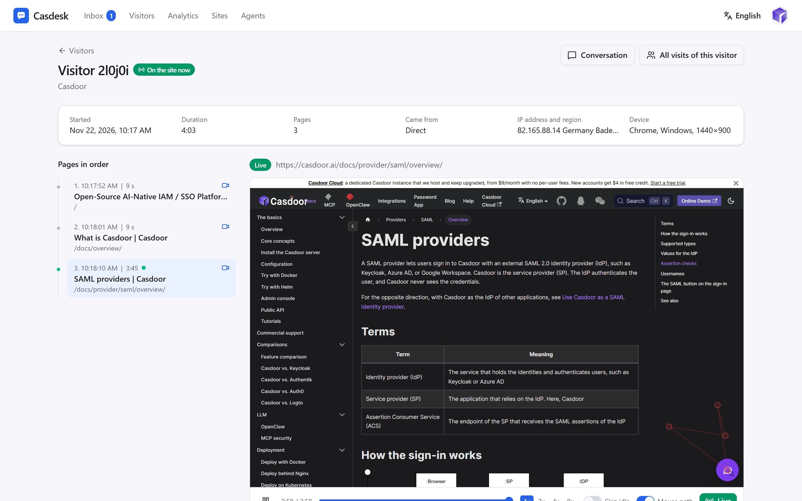
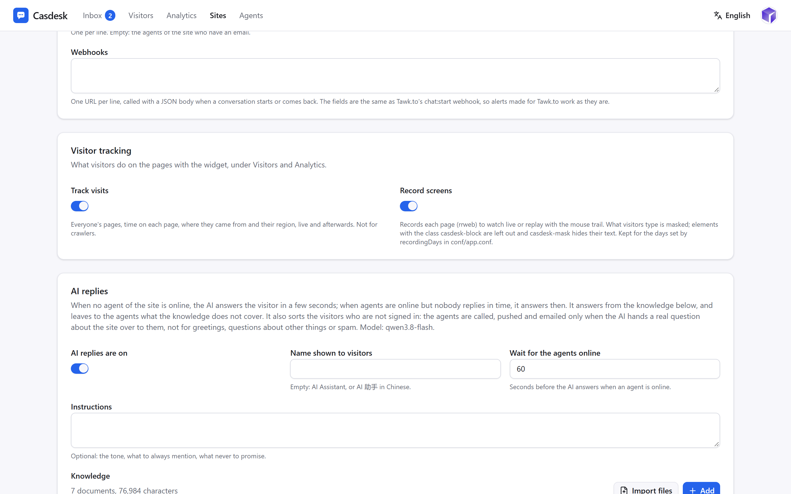

<div align="center">
  <a href="https://github.com/casdesk/casdesk">
    
  </a>

  <h1>Casdesk</h1>

  <h3>An open-source, self-hosted live chat for websites, with AI replies</h3>

  <p>
    A small chat widget for your pages and an inbox where your team answers the visitors.<br>
    An AI answers from <strong>your own documents</strong> when nobody is online, sorts out greetings and spam,<br>
    and calls your team only for the questions that need a person. One server, <strong>many websites</strong>.
  </p>

  <p>
    <a href="https://casdoor.ai"><strong>See it live</strong></a> &middot;
    <a href="#-features"><strong>Features</strong></a> &middot;
    <a href="https://github.com/casdesk/casdesk/issues"><strong>Feature requests</strong></a> &middot;
    <a href="https://discord.gg/5rPsrAzK7S"><strong>Discord</strong></a>
  </p>

  <p>
    <a href="https://github.com/casdesk/casdesk/stargazers">
      
    </a>
    <a href="https://github.com/casdesk/casdesk/issues">
      
    </a>
    <a href="#-source-code">
      
    </a>
    <a href="https://casdoor.ai">
      
    </a>
    
    <a href="https://discord.gg/5rPsrAzK7S">
      
    </a>
    <a href="LICENSE">
      
    </a>
  </p>
</div>

<div align="center">
  
  <p><sub>The inbox your team works in: every site's conversations, what the AI already answered, and who the visitor is and what they looked at.</sub></p>
</div>

<table>
  <tr>
    <td width="34%" valign="top" align="center" rowspan="2">
      
      <sub><b>The widget.</b> One line of HTML. The visitor asks, the AI answers from your documents, and the visitor can leave an email for the follow-up.</sub>
    </td>
    <td width="66%" valign="top" align="center">
      
      <sub><b>Visitors.</b> Who is on your sites now, the pages each one went through, and their screen, live or replayed, with every input masked.</sub>
    </td>
  </tr>
  <tr>
    <td width="66%" valign="top" align="center">
      
      <sub><b>Site settings.</b> Logo, colors, texts, agents, webhooks, tracking and the AI's knowledge, per site, in the console.</sub>
    </td>
  </tr>
</table>

## 📦 Source code

**Casdesk runs in production on our own sites, and the source code is coming here soon** under the Apache-2.0 license, as one Go binary with the console and the widget built in.

- ⭐ **Star** or 👀 **watch** this repository to know when it lands.
- 💡 [**Open an issue**](https://github.com/casdesk/casdesk/issues/new) to tell us what you would use Casdesk for, and what it must have before you switch: we decide what comes first from these.

## ✨ Features

**The widget**

- **One line to embed**: a plain script of about 15 KB gzipped, in a shadow root so it never clashes with your page's CSS. No iframe, no third-party cookies.
- **Looks like your product**: each site has its own logo, color, light or dark theme, greeting and agent avatars, in English or Chinese.
- **Your own button**: hide the round launcher and open the chat from any button with `Casdesk.open()`, or link to the chat's own page.
- **Signed-in visitors**: pass your user's ID with an HMAC, and your agents see who they are; the user gets the same conversation on every device.

**AI replies**

- **Answers from your own knowledge**: write or import Markdown documents for each site; when no agent is online, or nobody replies in time, the AI answers from them through any OpenAI-compatible API.
- **Knows what it does not know**: it says so when the documents do not cover a question, asks for an email, and hands the conversation to a person.
- **Triage before anyone is disturbed**: real questions go to your team; greetings, off-topic chats and spam stay with the AI or go to the spam folder. Block a visitor or an IP address in one click.
- **Any language**: the AI answers in the visitor's language.

**The inbox**

- **Many sites, one inbox**: filter by site, assign conversations, close and reopen them, search names, emails and messages.
- **Real time**: messages, typing and read receipts are pushed by long polling, which goes through any proxy or CDN.
- **Never miss a visitor**: a message nobody reads within a minute is emailed to the site's agents; a reply the visitor has not seen is emailed to them, with a link back to the conversation.
- **Webhooks**: called when a conversation starts, with the same fields as Tawk.to's `chat:start`, so your existing alerts (phone calls, chat bots) keep working.

**Visitors and analytics**

- **Who is on the site now**, the page they are on, where they are from (by IP address, offline lookup), and how long they have stayed.
- **Every page of every visit**, with an optional screen recording to watch live or replay, mouse trail included. Inputs are always masked; mark any element to hide it.
- **Analytics**: visits, pages, landing and exit pages, page flows, referrers, regions and devices, per site and per domain.

**Running it**

- **Single sign-on for agents** through any OpenID Connect provider ([Casdoor](https://github.com/casdoor/casdoor), Keycloak, Google...), or plain passwords.
- **One Go binary**: SQLite out of the box, or MySQL. Or Docker.

## 🧩 Embedding the widget

```html
<script src="https://chat.example.com/widget.js" data-site="example" async></script>
```

| Attribute | Meaning |
| --- | --- |
| `data-site` | The site's name (required) |
| `data-lang` | `en` or `zh`; by default the site's setting, or the visitor's browser language |
| `data-launcher="false"` | Hides the round button; open the chat from your own button with `Casdesk.open()` |

The page's script can call `Casdesk.open()`, `Casdesk.close()`, `Casdesk.toggle()` and `Casdesk.setUser({ id, username, name, email, hash })`. Each site also has a page of its own, `https://<server>/chat/<site>`, to link to from "Contact us".

## 🤔 Why Casdesk

We used a hosted live chat for years, and wanted one we could run on our own servers: one that answers with AI from our own documents, does not ring our phones for spam, signs our agents in with our own identity provider, and shows what a visitor was looking at when they asked. So we wrote Casdesk, small enough to run next to any website.

## 🤝 Feedback

Questions, ideas and feature requests are welcome in [Issues](https://github.com/casdesk/casdesk/issues) and on [Discord](https://discord.gg/5rPsrAzK7S).

## 📄 License

[Apache-2.0](LICENSE)
